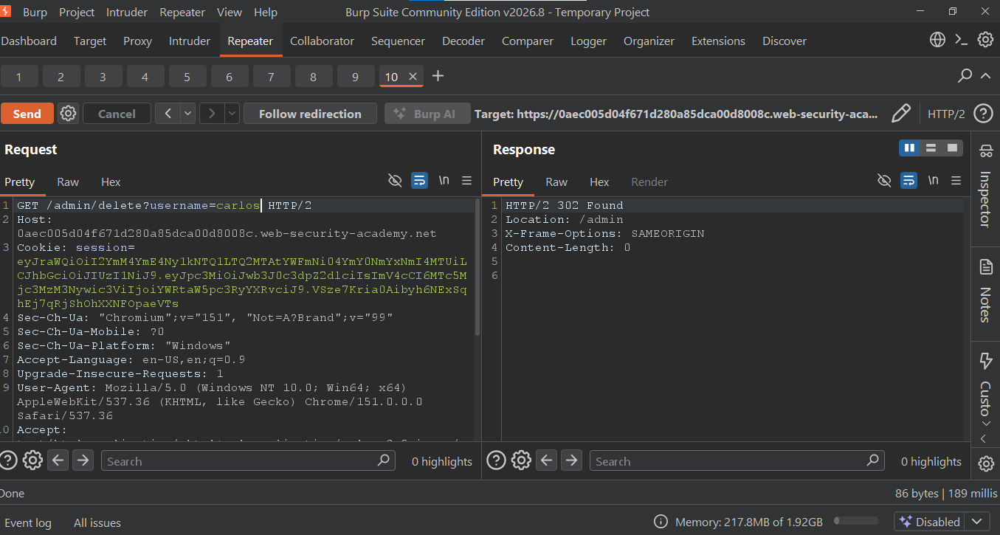
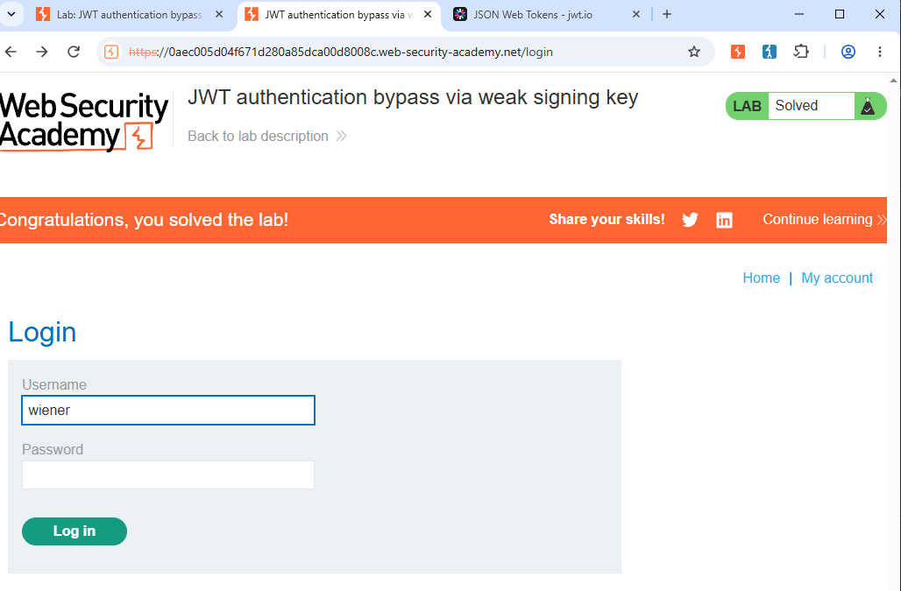

# PortSwigger Lab 11 - JWT Authentication Bypass via Weak Signing Key

## Description
This lab uses JWT for session handling with a weak signing key that can be brute-forced.

## Vulnerability
The server signs JWTs with a weak secret, allowing attackers to forge valid tokens.

## Exploitation Steps

**1. Login with `wiener:peter`**
Intercept the request and grab the JWT session cookie.

**2. Find the weak secret key**
Copy the JWT to https://jwt.io and brute-force the secret using dictionary attack. Found secret is weak and crackable.

**3. Forge Admin JWT**
Modify the payload to:

{
  "sub": "administrator"
}
Sign it with the cracked secret.

**4. Access Admin Panel**
Replace your session cookie with the forged admin token and request:
GET /admin HTTP/2
You will get 200 OK with user list: wiener, carlos.

**5. Delete Carlos**
GET /admin/delete?username=carlos HTTP/2
Response: 302 Found - User deleted.

**Result**
Lab Solved - Successfully bypassed JWT authentication and deleted user carlos.

**Tools Used**
Burp Suite
jwt.io

