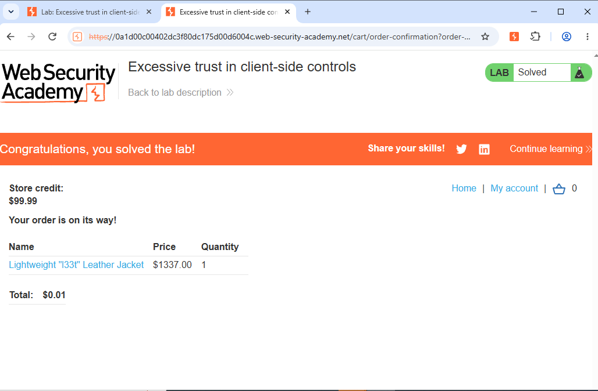

# Lab14: Excessive trust in client-side controls

**Lab Link:** https://portswigger.net/web-security/logic-flaws/examples/lab-logic-flaws-flawed-business-logic
**Category:** Business Logic Vulnerabilities
**Difficulty:** Apprentice

## Description
Shop sells Lightweight l33t leather jacket for $1337 but we have only $100 credit.

## Vulnerability
Excessive trust in client-side controls - Price Tampering
Server trusts client price parameter (CWE-472)

## Steps to Reproduce
1. Login wiener:peter
2. Burp Intercept ON
3. Add jacket to cart
4. Intercept: productId=1&quantity=1&price=1337.00
5. Change to price=0.01 and Forward
6. Cart shows $0.01
7. Place order - Lab Solved

## Payload
price=0.01

## Mitigation
Validate price from server-side database, never trust client data.

## Proof

